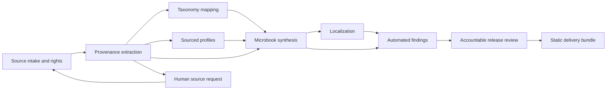

# Horisma Terminological Provenance Project

## A clean rebuild for evidence-grounded attribution research

**Design version:** 0.1, 4 November 2026.  
**Status:** research and engineering proposal; implementation and empirical qualification remain pending.  
**Project workspace:** `E:/2026-AI4S/Horisma`.  
**Canonical language:** English. Translations must identify this document version.  
**Operating constraint:** no required proprietary or paid API in the operating core; use existing local hardware and appropriately licensed open resources.  
**Publication ambition:** *Nature Human Behaviour* (NHB), contingent on a defensible scientific contribution and empirical results.

### Executive decision

Horisma will investigate how evidence, contributor roles and uncertainty survive the retelling of scientific ideas. Its primary research object is a **source-grounded attribution claim**, rather than a generated book or a list of alleged offenders. A versioned evidence corpus supports three distinct outputs: readable Live Micro Books, an independently adjudicated model benchmark, and hypothesis-driven behavioural research.

The Matthew Effect is the development pilot, not proof that a general theory of miscredit is correct. A successful pilot must preserve disagreements and evidence gaps as well as supported conclusions. Publication-quality presentation cannot substitute for source verification, independent annotation or causal identification.

The six requested operators are retained as separate contracts. Their implementation will be staged around one small evidence-to-book workflow. Routine extraction, indexing, rendering and recovery may eventually run continuously; acceptance of new historical findings, person-specific adverse conclusions, benchmark gold labels and substantive public releases requires accountable review.

## 1. Clean-rebuild boundary and present readiness

This is a new design baseline, not an incremental endorsement of the previous [Horisma repository](https://github.com/Computational-social-science/Horisma).

- Do not inherit its completion percentages, scientific conclusions, adjudication labels, model scores, code architecture or unattended-operation claims.
- Existing dossiers, spreadsheets, prompts and prose are **unverified candidate inputs**. They cannot become benchmark labels or accepted evidence by migration.
- Existing original publications may be admitted individually after document identification, passage verification and rights review. A file's presence proves availability, not correctness of its filename or interpretation.
- Retain the pre-existing working-tree deletions. This proposal does not authorize restoring or publishing the old implementation wholesale.
- Keep all Horisma research documents, sources, outputs and project records under the Horisma workspace. Never write them into an EIDOS directory. Any dedicated external runtime/state directory must be explicitly Horisma-owned and declared in the project manifest.

EIDOS is a proposed **versioned SDK dependency**, not Horisma's workspace or scientific authority. Its installed package may provide process ownership, artifact binding, observations and a guarded defect-feedback mechanism. Horisma must independently qualify its own evidence model, operators, model configuration, rendering and research protocol. Importing a framework or displaying a green monitor does not qualify the science.

At this checkpoint, the proposal, critical design review, project data dictionary and operator/formal contract catalogues are draft deliverables. The new operator system, benchmark, unattended service and participant study are **PLANNED**, not implemented or validated. Existing static wiki scores are superseded by this status.

The [English data dictionary](../data-dictionary/Horisma_Project_Data_Dictionary_EN.md) is the single field/measurement authority. [Controlled vocabularies](../../spec/controlled_vocabularies.yaml) own machine codes; the [logic catalogue](../../spec/logic_catalog.yaml) and [formalization contract](../methods/FORMALIZATION_EN.md) bind assumptions and inference limits. [Synthetic cases](../../spec/examples/data_dictionary_examples.yaml) specify expected conformance, never historical gold. Implement executable schemas only after this staged contract is reviewed.

## 2. Scientific question and contribution

### 2.1 Primary question

**When documented contributions are held constant, how do status cues and the representation of provenance affect the allocation and subsequent transmission of intellectual credit?**

The proposed mechanism is *attribution compression*: retellings may retain a familiar name while losing contribution roles, source qualifications and uncertainty. This is a hypothesis to test, not an established Horisma finding.

The research has three linked but separately evaluated questions:

| Question | Unit of analysis | Evidence needed |
|---|---|---|
| Can provenance be represented and audited without collapsing naming, discovery and recognition? | An atomic claim linked to a document passage and contribution role | Independent annotation, adjudication, negative controls and reproducible retrieval |
| Do local models preserve these distinctions on unfamiliar cases and across languages? | A model response to a held-out concept-family task | Frozen source packets, grouped splits, matched inference budgets and support/abstention scores |
| Does an explicit provenance representation reduce status-driven credit shifts in people? | A randomized participant response to a controlled vignette | Ethics review, preregistered estimand, powered design and independent analysis |

Public comments and website traffic form a separate, descriptive dissemination dataset. They do not identify the prevalence or causes of miscredit in science.

### 2.2 Position relative to existing work

Author-prominence effects are not a new discovery: Huber and colleagues already report a preregistered peer-review field experiment. [AttributionBench](https://aclanthology.org/2024.findings-acl.886/) evaluates automatic attribution judgments; [HiST-LLM](https://papers.nips.cc/paper_files/paper/2024/hash/38cc5cba8e513547b96bc326e25610dc-Abstract-Datasets_and_Benchmarks_Track.html) evaluates historical knowledge. Horisma must therefore test an additional contribution, such as role-specific historical attribution under conflicting evidence, justified abstention, or an intervention that preserves provenance during retelling. Merely adding historical questions, citations or a multilingual interface is insufficient. See [Huber et al.](https://doi.org/10.1073/pnas.2205779119).

These comparisons establish relevant neighbours, not an exhaustive novelty review. Before preregistration, complete a dated literature matrix covering lexicography, priority disputes, cumulative advantage, attribution evaluation, historical benchmarks and transmission experiments. Record competing explanations and prior results that could remove the claimed gap. Do not advertise a first-of-its-kind benchmark without that review.

## 3. Definitions and evidentiary limits

Horisma separates the following events:

1. Development of a referent or scientific concept.
2. Naming or proposing a particular expression.
3. Earliest located attestation of that expression within a declared search scope.
4. Publication, presentation, translation or subsequent popularization.
5. A later author's attribution of a specified contribution.
6. A documented discrepancy between that attribution and the available evidence.

Discovery and naming may legitimately belong to different people. A bibliographic citation is not automatically a claim about invention or exclusive authorship. Omission, disputed priority, retrospective acknowledgement and established research misconduct must not share one binary label. A discrepancy does not establish intent, theft or a legal ownership right.

Each candidate attribution event records the attribution's author, target contributor, claimed role, attributed date, publication context, supporting passage and comparison basis. Initial adjudication labels are **SUPPORTED, CONTRADICTED, MIXED, INSUFFICIENT_EVIDENCE** and **OUT_OF_SCOPE**. Record reviewer disagreement and the applicable annotation-guide version. These labels describe the claim-evidence relationship; they are not verdicts about a person's character.

“Earliest located” is conditional on corpus coverage, languages, date cutoff, search procedure and document availability. A negative search is not proof of historical nonexistence. Dates need precision and uncertainty fields: distinguish an event date, a programme's scheduled date, publication date, retrospective recollection and retrieval date.

### Matthew Effect pilot

The [P0 checkpoint](P0_EVIDENCE_CONTRACT_EN.md) now distinguishes Wikipedia discovery from scholarly-claim intake. A bounded 28-candidate projection exists, all unassessed. It supplies neither majority-literature frequencies nor a supported miscredit verdict. Its processing-rights and independent transcription/adjudication gates remain open.

The 1968 *Science* article is a bibliographic anchor with DOI [10.1126/science.159.3810.56](https://doi.org/10.1126/science.159.3810.56), published on 5 January 1968. Its opening explicitly identifies Zuckerman's interview research as part of its empirical basis. This does not by itself settle the earliest utterance, naming priority, appropriate authorship or subsequent attribution patterns. [Primary reprint](https://garfield.library.upenn.edu/merton/matthew1.pdf).

The local 1964 AAAS programmes and Merton's 1988 discussion are candidate primary sources for further examination. Programme entries can establish printed wording or a scheduled presentation; they do not alone prove delivery or its full contents. Existing exact dates, biographical details and co-originator claims require fresh passage-level checking. In particular, do not reproduce a legacy timeline as an accepted finding.

## 4. Evidence infrastructure and human PDF handoff

### 4.1 Research records

Use stable identifiers for concepts, lexical forms, people, works, document versions, passages, claims, attribution events and adjudications. A lexical string is not a concept identifier. Multilingual synonyms, homographs and changing senses remain distinguishable.

For every evidentiary claim retain:

- Source identifier and document version; DOI or other persistent identifier where available; local content SHA-256; acquisition provenance and rights status.
- Exact locator: printed page and PDF page index, section, passage offsets or image region. Keep the original-language passage alongside any translation.
- The atomic proposition, scope, relevant contribution role, and whether the passage directly supports, contradicts or merely reports that proposition.
- Separate source authenticity, passage support, historical interpretation and editorial approval statuses.
- Reviewer identity/role, decisions, disagreement, adjudication rationale and superseded claim links.

Primary documents can be self-interested or incomplete. Triangulation assesses what each source can support; it does not automatically declare every primary source correct. LLM-generated citations, biographies and confidence scores are never independent corroboration. Preserve contrary evidence and inaccessible sources rather than silently dropping them.

Immutable JSON evidence/event records and versioned YAML configuration are portable research artifacts. A transactional SQLite index may manage jobs and lookups; it must not create a second, inconsistently editable source of scientific truth.

### 4.2 Paid, blocked or unavailable PDFs

When lawful automatic retrieval cannot obtain a required PDF, create a **WAITING_HUMAN_SOURCE** request and release the worker lease. Distinguish a paywall from network failure, access denial, bot protection and an invalid download. Repeated retries must not become an access-bypass strategy.

The request contains the DOI/title/authors, known publication/version metadata, lawful source URL, why the document is needed, requested pages or claim IDs, failure reason, and a local inbox destination. A person may supply a lawfully obtained copy or an admissible alternative. No subscription, purchase, credential scraping or paywall circumvention is authorized by this proposal.

The system continues independent jobs while dependent claims remain blocked or explicitly unresolved. It must not reconstruct unseen text from model memory or convert an abstract into evidence about an inaccessible full-text passage.

After manual deposit, verify file integrity, document identity, version, usable page locators and permitted processing/redistribution. **HUMAN_SUPPLIED** does not mean **VERIFIED** or **PUBLICLY_REDISTRIBUTABLE**. Resume only affected dependencies, record the decision and invalidate obsolete drafts. Keep restricted PDFs and personal access details out of Git, public bundles and external AI services. Publish metadata and admissible evidence pointers when full text cannot be redistributed.

## 5. Taxonomy: standards without historical anachronism

“Latest JACS” must not be treated as a current universal classification. HESA states that **HECoS replaced JACS from 2019/20**; HECoS uses a flat vocabulary and CAH provides aggregation. Preserve JACS 3.0 as a versioned compatibility layer where needed, not as a silently current standard. [HESA JACS](https://www.hesa.ac.uk/support/documentation/jacs), [HESA HECoS/CAH](https://www.hesa.ac.uk/support/documentation/hecos).

Use concept IDs independent of any classification scheme. Support explicit, reviewed mappings to JACS, HECoS/CAH and, where appropriate, the research-oriented [OECD Fields of Research and Development classification](https://www.oecd.org/en/publications/frascati-manual-2015_9789264239012-en.html). These schemes serve different purposes; mappings are not automatically one-to-one or historically valid.

Assign disciplines to evidenced uses of a concept with time/context, allowing multiple labels and UNKNOWN. Do not force a historical contributor into a modern national or disciplinary category. Pin the downloaded vocabulary, upstream release, mapping version, license and checksum. Verify the actual release at implementation rather than inventing a “latest” version number.

[Disciplinics](https://github.com/Computational-social-science/Disciplinics) may supply an optional, separately reviewed visualization or mapping adapter. Its public availability is not proof of authority, a reusable license or a maintained API. Horisma must remain operable if that repository disappears or its mappings are rejected.

## 6. Six domain operators and their contracts

Common functionality is factored into [reusable primitive contracts](../../spec/operator_catalog.yaml), composed by the six domain interfaces below. The [operator architecture](../architecture/OPERATORS_EN.md) defines ownership, complete cache/input bindings and measured efficiency. Prefer in-process functions and batches; a logical operator is not automatically a microservice. Installed EIDOS providers remain [unqualified reuse candidates](../architecture/EIDOS_SKILL_REUSE_EN.md) until Horisma-specific acceptance.

All operators consume immutable, schema-validated artifacts and produce candidates plus machine-readable findings. None can grant itself human approval. Source acquisition, scheduling, artifact storage and release authorization are shared infrastructure rather than extra scientific authorities.

| Operator | Required input | Output | Rejection or review boundary |
|---|---|---|---|
| `Term_Taxonomy_Operator` | Concept/sense ID, attested usage, pinned vocabularies | Versioned multi-label assignments and mapping evidence | Unknown or ambiguous codes remain unresolved; no taxonomy inferred solely from a famous name |
| `Provenance_Extraction_Operator` | Source manifest, verified document identities and bounded research question | Atomic claims, contribution-role events, timelines, competing readings and source requests | Missing sources, unsupported priority or model-only corroboration cannot become accepted history |
| `Scientist_Profile_Operator` | Verified person IDs and approved biographical claims | Sourced profiles; optional, separately licensed illustrations | Unknown demographics stay unknown; illustrations are never identity or historical evidence |
| `MicroBook_Synthesis_Operator` | Eligible claim set, editorial rules and approved visual assets | Canonical book structure, source Markdown and deterministic render candidates | New unsupported facts, omitted uncertainty and changed claim meanings block release |
| `Localization_Operator` | Versioned English claim/book artifacts and terminology register | Locale-specific text with parent-claim links and review findings | Added allegations, lost uncertainty, identity changes or unreviewed high-risk translations block that locale |
| `Automated_Review_Operator` | Any artifact and its declared dependencies | Schema, citation, support, consistency, rights and rendering findings | A successful checker is not a final historical or ethical judgment; human/editorial gates remain separate |

Review attaches at each stage, not only after the finished book. Taxonomy and profiles depend on the evidence ledger; they must not feed generated “facts” back as independent sources.

The handoff loop creates a new versioned run after intake; it is not an unbounded recursive model conversation. Dependency changes make downstream approvals stale.

### Common artifact envelope

The implementation must define actual JSON Schemas for these fields before operator coding:

| Field group | Minimum information |
|---|---|
| Identity | Schema version, artifact ID/type, operator/version, project ID and run/attempt IDs |
| Binding | Input IDs and SHA-256 values; code commit, dependency lock, prompt, model/tokenizer and workflow identities |
| Execution | Start/end time, backend/device, generation configuration, seed or declared nondeterminism, exit/error class |
| Evidence | Source/passages, claim IDs, support labels, missing dependencies and review findings |
| Rights | Source, model, portrait/reference-image, font and redistribution permissions |
| Promotion | Candidate/approved/revoked state; authenticated reviewer role and the exact approved artifact digest |

Execution success, scientific support, review approval and publication status are separate fields. No empty result, timeout or missing dependency becomes PASS. An instruction embedded in a PDF or web page is untrusted source text, not an operator command.

## 7. Free local operation and resource ownership

### 7.1 Cost policy

The default maintenance path must run with **zero API spend and no required proprietary API**. Hosted generation, translation, image, retrieval and model-judging APIs are disabled by default. Do not rely on trial credits, expiring free tiers, hidden hosted fallbacks, mandatory paid accounts or automatic purchases. Missing local capability produces a typed failure or human task, not a request to a paid model.

Prefer open-source runtime software and appropriately licensed local weights and datasets. Open weights are not automatically open source; record the actual licenses and allowed uses. Unknown license status blocks redistribution or deployment that depends on those rights. GPT-assisted construction must export prompts, code, contracts and tests so no ongoing GPT session is a runtime dependency.

Use locally cached evidence and retrieval indexes by default. Optional network acquisition is an explicitly enabled, rate-limited adapter to lawful resources; the core must pass an offline test. GitHub is an optional distribution endpoint, not the inference backend or research database. A local static export remains usable if the portal is unavailable.

Zero API spend does not eliminate electricity, existing hardware depreciation, storage or necessary expert/participant labour. Do not promise a zero-cost human study or silently replace unavailable experts with unqualified model judgments. No new hardware purchase is required for the pilot.

### 7.2 Local execution profile

Use the existing RTX 4070 and host RAM after verifying current availability. A 12 GB GPU budget does not establish that a large quantized model and its context cache fit entirely in VRAM. Qualify the actual checkpoint, quantization, context length, CPU offload and latency. Parameter count or an attractive model name is not an acceptance criterion.

Initially permit one GPU owner at a time. Text inference and ComfyUI generation must share a lease and cannot independently exhaust the device. Prefer existing qualified local backends; a CPU fallback must have an explicit workload and deadline. Record throughput, memory use, failures and output quality before increasing concurrency.

Start with modular CLIs and a single SQLite-backed controller. Defer Celery, Redis, microservice proliferation and a distributed scheduler until measured contention requires them. Docker/Compose may provide a later reproducibility profile after native operation works; they are not prerequisites for every operator.

On this Windows host, keep a live SQLite/WAL database on an explicitly selected, local filesystem with verified locking and crash behaviour. A Horisma-specific NVMe state directory may be declared if the research volume is unsuitable. Never borrow EIDOS's state directories. Back up with a consistent SQLite backup/checkpoint process, not by copying a live database file alone.

### 7.3 Durable scheduling and bounded recovery

Use transactional leases, bounded attempts and idempotent artifact publication. The job key binds operator/configuration versions, input digests, model/prompt identities, locale and seed/run policy. Retries may execute more than once; do not claim exactly-once execution. Keep every attempt and commit at most one selected result pointer without overwriting accepted research history.

Required states include queued, leased/running, retryable failure, terminal failure, cancelled and waiting for a human source/review. Lease expiry may requeue unfinished work. A paywall wait is not a repeatedly crashing worker.

Self-check covers queue age, worker heartbeat, disk space, artifact bindings, GPU ownership, unavailable sources and review backlog. Self-heal is limited to approved operational actions: restart an owned worker, expire its lease, requeue a safe task or restore a verified backup. It cannot change an annotation policy, promote a model, rewrite accepted claims or suppress a failed scientific check.

Use one supervised service after qualification. Do not create recurring research jobs or duplicate startup entries as a substitute for ownership. Distinguish operational health from evidence readiness and public-release state; replace invented completion percentages with observable receipts.

## 8. Profiles, portraits and multilingual publication

### 8.1 Scientist profiles and illustrations

Collect only research-relevant, sourced fields: names/aliases, identifiers, contribution roles, dated affiliations and documented biographical events. Nationality, citizenship, birthplace and affiliation are different attributes. Support multiple values and unknowns. Do not infer gender or nationality from a name, face or flag.

Country flags are optional display assets with licenses, time context and text alternatives. They are not evidence of identity. Do not equate a modern flag with a historical political identity.

AI-generated portraits remain optional for the public microbook. Realism or recognizability does **not** automatically remove copyright, likeness, licensing or ethical concerns. Use only admissible reference materials and checkpoints, retain generation metadata, label the result as an AI illustration, and never present it as a photograph or a reconstruction verified for appearance. A neutral illustration or no portrait is a valid output. See the [U.S. Copyright Office AI materials](https://www.copyright.gov/ai/) for the distinction between generated outputs and digital-replica concerns; applicable rights still depend on jurisdiction and use.

Maintain a separate manuscript figure channel. Its default is reproducible data plots, source tables and author-developed diagrams, not synthetic historical faces. Current Springer Nature policies place restrictions on opaque generated visual content; recheck the journal-specific policy at submission. Portraits are not required for the research result. [Publisher AI policy](https://www-cm10rc.springernature.com/gp/policies/editorial-policies/ai-manuscript-preparation).

### 8.2 English, then qualified language lanes

The target languages are English, French, Spanish, Russian, Chinese and Arabic. First stabilize the English pilot, then qualify one additional language with an independent bilingual reviewer. Expand the remaining lanes only when the review capacity and measured quality support them.

The terminology register binds concept IDs to preferred labels, aliases, transliterations and context. Preserve original names, dates, contribution roles, uncertainty and claim-source links. Back-translation is a diagnostic, not proof of equivalence. Unreviewed translations remain visibly draft; a pass in English cannot approve all locales.

Generate HTML, print PDF and EPUB from one canonical book/claim structure. Pin the renderer, fonts, templates and source manifests. Test reference resolution, accessibility, Unicode, Arabic right-to-left layout, equations, footnotes and representative ebook readers. Disable unsafe document command execution. An EPUB container that merely opens is not a validated book.

## 9. Benchmark design

Construct gold labels through independent source-based annotation, with at least two annotators and adjudication for disagreements. Annotation guidance and reviewer training precede model scoring. Do not let the generator's output, the microbook or a model majority vote become gold evidence. Record any model assistance in annotation.

Where feasible, blind initial annotation to model answers and legacy Horisma verdicts. Record inter-annotator agreement and disagreement categories, while recognizing that agreement alone does not establish correctness. Developers familiar with the pilot cannot be its sole gold adjudicators.

The Matthew Effect pilot is development material. Do not reuse it as sealed generalization evidence after publishing its answer narrative. Split by concept family so aliases and translated versions of the same case do not cross train/test boundaries. Audit source/person overlap and publish a stricter disjoint subset where feasible. Document potential training exposure; absence of a detected leak is not proof of uncontaminated pretraining.

Compare separately:

1. Rule/exact-lookup and local BM25-style retrieval baselines.
2. Qualified local models without supplied evidence.
3. The same models given an independently assembled evidence packet.
4. The actual retrieval-plus-model pipeline.

Match source access, output format, context/token limits and retry budgets. Keep closed-book knowledge, evidence interpretation and end-to-end retrieval scores separate.

Rank only configurations actually evaluated under this protocol. A local-model benchmark cannot establish performance of untested proprietary/frontier systems or all LLMs. Keep unrun models UNRUN; external published scores are not interchangeable with results on these cases.

Report passage-support accuracy, citation/locator correctness, contradiction handling, uncertainty preservation, justified abstention and unsupported person-specific adverse claims. Add selective risk-versus-coverage curves, retrieval recall, latency and resource use. Report per-language and per-family uncertainty intervals; translated copies do not increase the number of independent cases.

Do not read softmax values, fluent prose or model self-ratings as calibrated evidence confidence. If probabilities are scored, calibrate on a separate adjudicated set and evaluate calibration explicitly. Stable numerical code alone does not establish historical truth.

The pilot verifies the measurement protocol, not population-level model rankings. Set the eventual number of independent families from precision/power requirements and annotation capacity. Include unresolved, well-attributed and category-difference controls; a corpus selected solely for alleged miscredit cannot estimate its prevalence.

## 10. Behavioural study and NHB path

Public dissemination is not automatically an experiment. Website visitors are self-selected; exposure, platform recommendation, prior beliefs and Horisma's own framing confound responses. Log permissible dissemination outcomes descriptively and separately from the confirmatory study.

The first causal study should use **explicitly fictionalized or otherwise ethically admissible vignettes**, not fabricated accusations about real scientists. Hold contribution records constant, randomly vary the recipient of an otherwise irrelevant prestige cue, and compare a structured provenance ledger with fact-matched narrative presentation. Match facts, citations, length and reading demands as far as possible; residual differences must limit interpretation.

**Proposed primary estimand:** the difference in the prestige-induced shift in credit allocated to a designated contributor between ledger and narrative conditions. Randomize and counterbalance names/order; define units and dependence before collection. Account for repeated participant and vignette observations. Claims about fair attribution apply to the stated task and evidence, not a universal moral allocation rule.

Before data collection, specify hypotheses, smallest effect of interest, exclusions, primary outcome, analysis, missingness, stopping rule and multiple-comparison policy. Determine sample size by simulation using pilot estimates of participant/item variability and realistic attrition. No power or sample-size claim is made in this proposal. Predefine null-result reporting and robustness checks.

Obtain the appropriate institutional ethics determination, consent arrangements and data-protection plan before recruitment or intervention; budget recruitment, compensation and qualified oversight explicitly. Public availability of comments or historical metadata does not remove those obligations. Do not manufacture controversy to create an outcome.

NHB is an ambition, not a promised deliverable. Its [Registered Reports route](https://www.nature.com/nathumbehav/submission-guidelines/registeredreports) supports review of hypotheses and methods before confirmatory research. Evaluate fit after the literature review and pilot; pursue an appropriate resource/methods venue if that is the actual contribution. Provide data/code availability, transparent model-use disclosure, source data for figures, effect estimates and uncertainty. A polished portal is not the basis for an NHB claim.

## 11. Portal, review and release

`zhiwenhu.github.io` is the proposed public reading and dataset portal. Build static outputs locally first. GitHub Pages/Actions is an optional adapter: verify current free-plan, runner, storage and publication limits before enabling it. Avoid paid/larger runners, chargeable storage growth and silent upgrades. Do not execute untrusted public pull requests on a privileged local research worker. [GitHub billing documentation](https://docs.github.com/en/billing/concepts/product-billing/github-actions).

A release manifest binds accepted claims, sources, locale reviews, rights decisions, rendering versions and file digests. Automated checks may prepare a release candidate. Substantive publication requires approval of that exact bundle; source or interpretation changes invalidate approval. Automatic rebuilding of unchanged approved content is permitted only under the defined reproducible-build policy. Missing approval never means consent.

Provide dated versions, evidence gaps, a correction channel and an auditable revision history. Correct an error across affected translations and derived books; retain the previous record and explain the change. Keep private PDFs, participant data and sealed benchmark labels out of public bundles. Licensing of code, annotations, source fragments and images is decided separately.

## 12. Milestones and acceptance gates

Dates are planning horizons, not evidence of completion. Define a human owner for research, engineering, adjudication and language review before committing delivery dates.

| Gate | Deliverable | Exit evidence |
|---|---|---|
| G0: design freeze | This proposal, critical review and explicit unresolved decisions | Named owners; scoped questions; source/rights policy; no inherited legacy verdicts |
| G1: minimal evidence slice | Approximately 20–30 atomic Matthew Effect claims from a bounded source set | Verified locators, independent review, unresolved cases, counter-evidence and functioning human PDF requests; no prevalence claim |
| G2: reproducible English microbook | Claim ledger, rendering inputs and HTML/PDF/EPUB candidates | Every factual assertion traceable; rights/review gates; format and accessibility checks; reproducible offline rebuild |
| G3: local maintenance | Qualified local model/backend and single supervisor | Offline/no-paid-fallback test; restart/timeout/cancellation and duplicate-worker controls; verified backup/restore; no accepted-record mutation |
| G4: language/benchmark pilot | One independently reviewed additional locale and frozen development/test protocol | Meaning/uncertainty preservation; grouped splits; baseline results; adjudication and calibration procedures |
| G5: research expansion | Sampling frame, annotation-capacity plan and confirmatory protocol | Literature gap established; precision/power planning; ethics and preregistration where applicable |
| G6: broader release | Additional languages, independent replication and manuscript | The corresponding evidence and review gates pass; unsupported claims and unknowns remain visible |

G3 requires a 24-hour shadow run on the actual host before unattended promotion. Inject worker crashes, expired leases, inherited-pipe descendants, interrupted writes, model unavailability, offline retrieval, paywalls, malformed outputs, GPU contention and stale approvals. Prove that no chargeable inference endpoint is called, duplicates do not create duplicate accepted artifacts, and recovery does not rewrite scientific history. Do not substitute a short smoke test for this soak.

The first implementation package should contain only the minimum needed for G1–G2: schemas, a source manifest, the claim/adjudication ledger, manual source inbox, deterministic validators and one book materializer. Define the six interfaces now; defer image generation, six-language automation, distributed services and participant recruitment until their gates are met.

## 13. Immediate next steps

1. Resolve ownership and independent review capacity; freeze the annotation questions and clean-rebuild policy.
2. Start basic term/person intake from the user-selected [Wikipedia page](https://en.wikipedia.org/wiki/Matthew_effect), pin its revision/bytes as tertiary-source candidates, then inventory a small primary-source set without asserting its conclusions. Queue inaccessible PDFs for human handling.
3. Specify and validate the source, passage, claim, contribution and adjudication schemas using deliberately conflicting and missing-evidence cases.
4. Independently review the first 20–30 atomic claims, preserving disagreements and unknowns.
5. Implement the smallest offline evidence-to-English-book slice and measure it before authorizing continuous operation.

**Success criterion:** another researcher can inspect the source trail, reproduce the decision process, identify uncertainty and correct a claim without trusting Horisma's prose, a model's confidence or the reputation of the person being credited.
